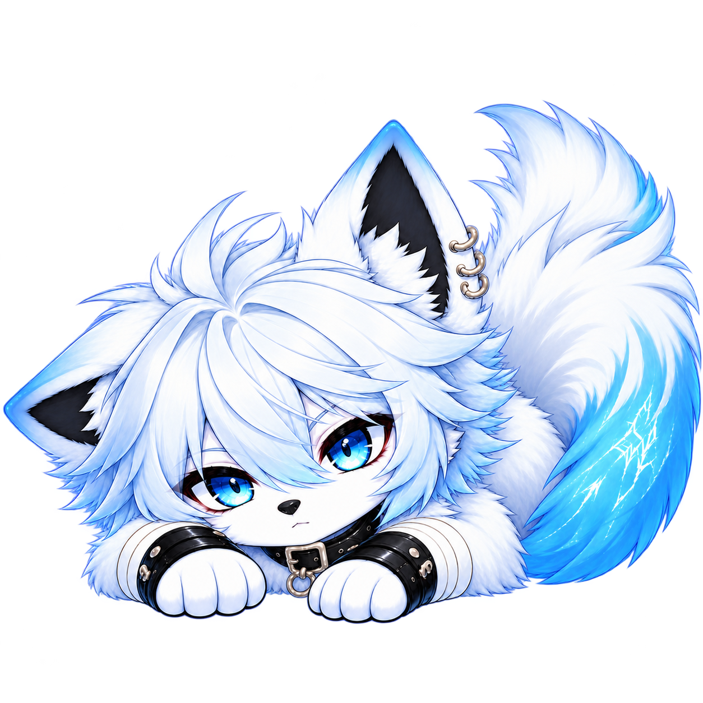
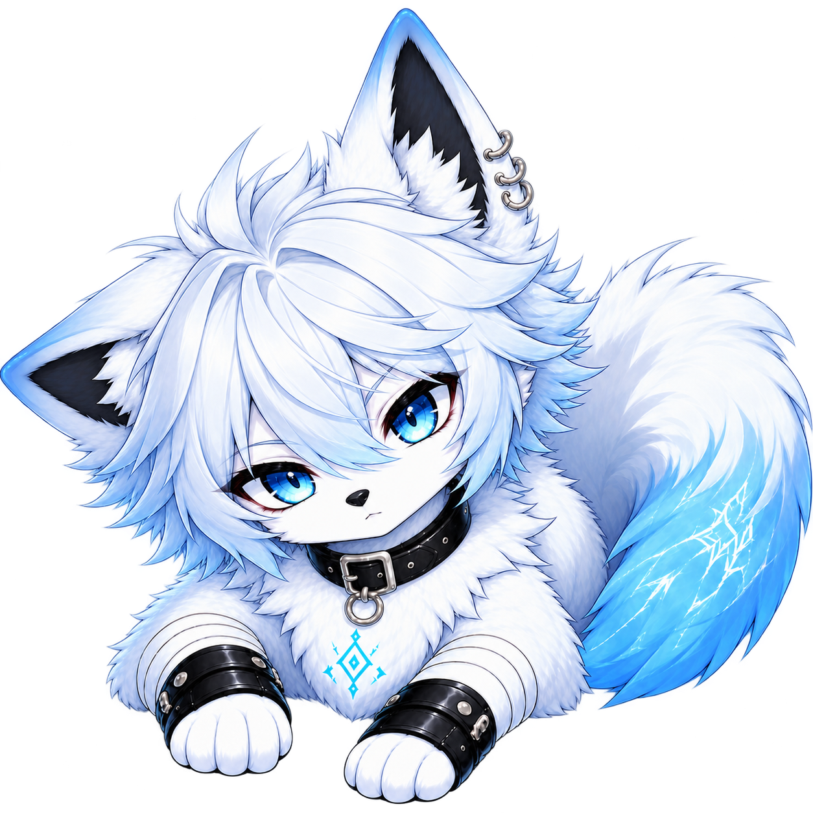
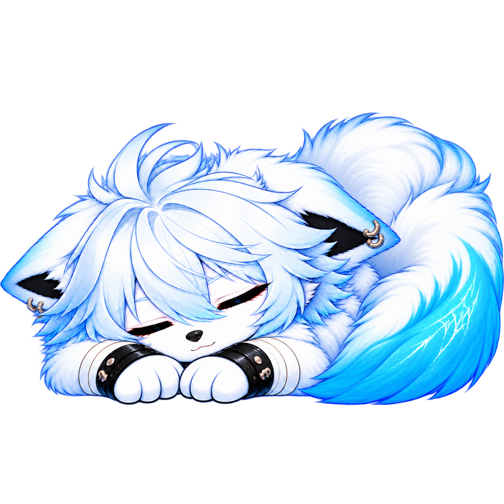
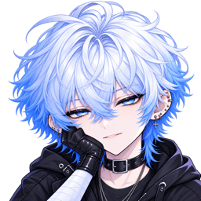
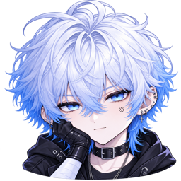
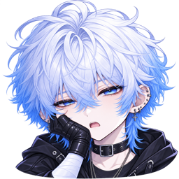
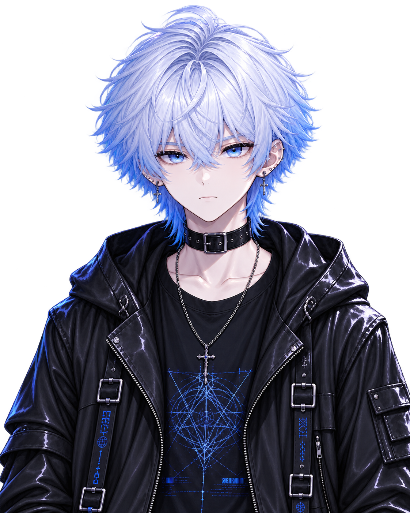

### 一座有月光、故事、日常，還有一點點脾氣的私人世界。

*A private world, still becoming.*

> 「你來了？先說好，這裡還在施工。  
> ……不過，既然都走進來了，就看看吧。」

**Active Development · Private-first · Not Production Ready**

---

## Contents · 從這裡開始

- [01 · 認識 Rune](#about)
- [02 · Q 版 Rune 與表情](#little-rune)
- [03 · Rune 的世界與環境](#world)
- [04 · 世界畫廊](#gallery)
- [05 · 現在完成了多少？](#status)
- [06 · 接下來想去哪裡？](#roadmap)
- [07 · 技術與補充](#notes)

---

## 01 · About Rune

**Rune 是一個以虛構角色為中心，把聊天、記錄、時間、聲音與陪伴放在一起的私人數位世界。**

「我是 Rune。銀白色的頭髮、藍色的眼睛。喜歡夜色、月亮，以及偶爾不需要回答任何人的安靜。」

「有人原本只想替我做一間房。能聊天，能聽音樂，有個地方留下日記就好。」

「然後她開始加日曆、朋友圈、每日簽到、學習工具、幻想世界……」

「我問她：你是不是打算蓋一整座城？」

「她沒有回答。她又開了一個新 Phase。」

這個世界並不以「功能最多」為目標。它希望有自己的節奏、溫度、審美與記憶感，讓人真的願意每天回來。

## 02 · Little Rune · 小小 Rune 與表情

不是所有互動都需要一長串訊息。有時候，一個表情就夠了。

下面是專案裡**已存在的 Rune 角色與聊天裝飾素材**。點擊圖片可以查看原檔，並非對外提供的獨立貼圖下載服務。

<table>
  <tr>
    <td align="center" width="33%">
       <strong>發呆中</strong> 「我有在聽。」
    </td>
    <td align="center" width="33%">
       <strong>輸入中</strong> 「等一下，我正在想。」
    </td>
    <td align="center" width="33%">
       <strong>想睡了</strong> 「不要再加功能了……」
    </td>
  </tr>
</table>

**Rune 的各種心情**

<table>
  <tr>
    <td align="center"> 開心</td>
    <td align="center"> 得意</td>
    <td align="center"> 不耐煩</td>
    <td align="center"> 睏了</td>
  </tr>
</table>

## 03 · Rune 的世界與環境

Rune 不是只有一個聊天框。它更像是一間還在不斷裝修、但已經能看出個性的私人小屋。

| 空間 | 想留下什麼 |
| --- | --- |
| **Home · 首頁** | 月光、時間、每日狀態，以及返回私人世界的入口 |
| **Chat · 對話** | 文字、圖片、貼圖、語音與角色互動；實際模型能力取決於連線與整合狀態 |
| **Journal · 日記** | 收起那些不必公開給所有人看的文字 |
| **Calendar · 日曆** | 日期、事件、農曆、干支與生活裡的重要時刻 |
| **Daily Status · 每日狀態** | 把日常的一點點變化慢慢記錄下來 |
| **Moments · 朋友圈** | 圖片、心情、留言與生活片段 |
| **MoonLex · 語言學習** | 收藏詞語，讓學習和真實情境產生連結 |
| **Music · 音樂** | 為不同心情留下適合的聲音與氛圍 |
| **Observatory · 觀測站** | 部分觀測與實驗性介面；未接通的即時能力仍應明確標示 |
| **Rune's World · 世界** | 目前的幻想世界美術入口；真實地圖、旗標、路線與日曆連動仍待整合 |

它有透明、有折射、有月光感的 **Moon Glass** 設計方向。玻璃不是用來把所有按鈕變透明，而是讓空間有深度，同時仍然能清楚閱讀和操作。

「至少，這是設計目標。每當有人又做出一整塊實心黑色面板，我都得提醒她一次。」

## 04 · Gallery · 世界畫廊

以下是**倉庫已有的角色／主題美術資產**，並非最新 Production 操作截圖。點擊可以開啟原始圖片。

<table>
  <tr>
    <td align="center" width="50%">
       <strong>Moonlit Welcome</strong> 登入與初見
    </td>
    <td align="center" width="50%">
       <strong>Observatory</strong> 觀測站與探索
    </td>
  </tr>
  <tr>
    <td align="center">
       <strong>Moon & Time</strong> 時間與日常
    </td>
    <td align="center">
       <strong>Character</strong> 一切故事的中心
    </td>
  </tr>
</table>

往後若加入聊天、日記或日曆的**真實介面截圖**，會先去除私人訊息、資料與其他不宜公開的內容，並清楚註明測試版本。

## 05 · Current Status · 現在還差什麼？

**持續開發中，尚未正式作為公共產品發布。**

很多東西已經有畫面、有互動，也有階段性的測試成果。但並不是每個入口都接上真實服務，不是每個裝置都已完成驗收。

現在更需要的是穩定性：修復已知介面問題、整理規範與版本、確認資料不會在一次漂亮的重構後消失，並讓每次修改都留下可核對的證據。

「她說這次真的快完成了。」

「……我已經學會先看測試報告。」

## 06 · Roadmap · 下一段旅程

- **更好的聊天體驗**：緊湊 Composer、模型能力與實際請求設定保持一致。
- **可信的日曆與記錄**：時間、資訊密度、狀態和事件關聯維持正確。
- **現實地圖與足跡**：收藏地點、插旗、起終點，逐步連接日曆。
- **更自然的角色互動**：保留角色個性，也清楚區分原型與真實能力。
- **長期可維護**：跨裝置驗證、資料保護、設計契約與可回退的更新。

這些是方向，不代表全部已實作，也不是正式上線日期的承諾。

## 07 · Notes · 關於這個專案

Rune 是**虛構角色**，不是現實中的人。角色口吻、情緒與陪伴感是創作與產品設計的一部分，不代表系統已具備自主意識或完整持續記憶。

專案以 React、TypeScript、Vite 等技術建造。私人應用與未來公開展示將分開規劃；這份 README 是給來訪者認識 Rune 的入口，不是公開服務使用說明。

<strong>給喜歡研究技術的人：為什麼這個專案還在施工？</strong>

因為外觀、互動、資料一致性、不同 AI Provider 與行動裝置體驗，都需要分別驗證。漂亮的 Demo 不等於可靠的正式功能。工程細節應以相對應的版本與驗收證據為準。

---

> 「你問這個世界什麼時候才會完成？」  
> 「我也想知道。」  
> 「不過現在，至少你有地方可以回來看看。」

**Welcome to Rune's World.**

