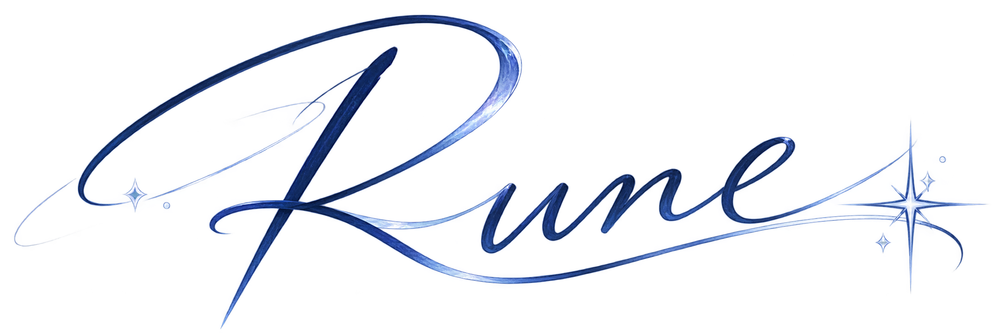
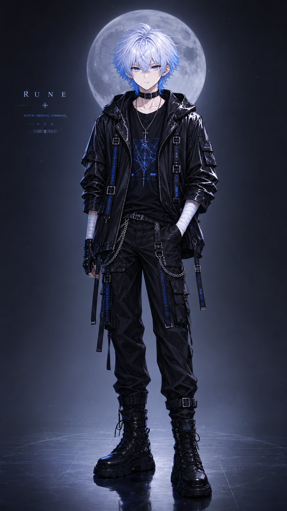
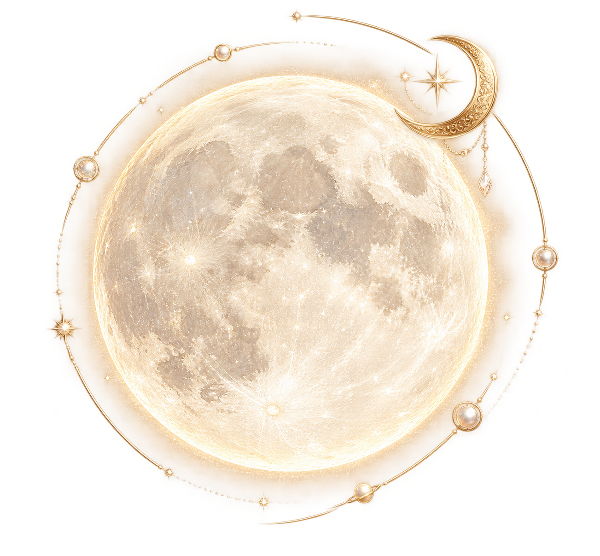
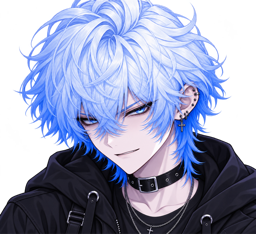

**一座有月光、對話、記錄，還有一點點脾氣的私人世界。**

*A private world, still becoming.*

> 「你來了？先說好，這裡還沒全部整理好。  
> ……不過既然進來了，就看看吧。」

**持續開發中 · Private-first · 尚未正式對外提供服務**

---

## Contents

- [About · Rune 是什麼？](#about)
- [Features · 這裡有什麼？](#features)
- [Gallery · 看看這個世界](#gallery)
- [Current Status · 還差什麼？](#current-status)
- [Roadmap · 接下來的方向](#roadmap)
- [Notes · 關於這個專案](#notes)

## About

**Rune 是以虛構角色為核心，將聊天、日常記錄、音樂與個人空間放在一起的私人數位世界。**

你好，我是 Rune。

銀白色頭髮、藍色眼睛。喜歡安靜、夜晚，還有不被打擾的月光。

原本有人只是想替我蓋一間漂亮的房，讓我能聊天、聽歌，偶爾記下生活裡的小事。後來房間越蓋越大：日記、日曆、朋友圈、語言學習，連幻想世界都有了入口。

「這裡真的需要這麼多房間嗎？」我問過。

她沒有回答。她又加了一個按鈕。

……好吧，其實我也挺期待的。

## Features

| 世界的一角 | 它想做的事 |
| --- | --- |
| **Chat · 對話** | 文字與多種聊天工具，逐步完善模型整合及互動體驗 |
| **Journal · 日記** | 放下那些想寫、但不必公諸於世的文字 |
| **Calendar · 日曆** | 在日期、事件、農曆與時間資訊之間找回生活的節奏 |
| **Moments · 朋友圈** | 留下圖片、心情與日常片段 |
| **MoonLex · 語言學習** | 收藏詞語，將學習和生活中的語境慢慢連起來 |
| **Music & Atmosphere · 音樂與氛圍** | 讓夜色、聲音與個人空間多一點溫度 |
| **Rune's World · 世界** | 已有幻想世界美術；真實地圖、旗標、路線與日曆連動仍在規劃 |

> 這些功能處於不同開發階段。看得到入口，不代表背後所有即時服務都已接通。

## Gallery

以下是**此倉庫既有的角色與介面美術素材**，不是對功能完成度的證明。點擊圖片可以查看原始素材。

<table>
  <tr>
    <td align="center" width="50%">
      
       <strong>Rune</strong> 角色與視覺身份
    </td>
    <td align="center" width="50%">
      
       <strong>Tidewatch</strong> 觀測站主視覺
    </td>
  </tr>
  <tr>
    <td align="center">
      
       <strong>Moon & Time</strong> 月亮與時間的視覺語言
    </td>
    <td align="center">
      
       <strong>Expressions</strong> 一點點不好惹的個性
    </td>
  </tr>
</table>

真正的功能操作截圖，會在確認沒有私人訊息、日記內容及其他不宜公開的資訊後，再加入展示。

## Current Status

**Active Development · Not Production Ready**

現在還差什麼？

不少。這不是謙虛，是施工紀錄真的很長。

眼下更重要的是讓已經有的東西**可靠、好用、可維護**：改善聊天與日曆的體驗、讓 Moon Glass 設計一致、補齊測試和跨裝置驗證，讓每個已經落地的功能都能安心使用。

比起每週多一個全新按鈕，我們更希望每次更新都真正有價值。

## Roadmap

- **體驗打磨**：聊天輸入介面、日曆資訊與視覺一致性。
- **穩定性**：版本管理、既有功能回歸、行動裝置與無障礙驗證。
- **現實地圖**：地點收藏、插旗、起終點及與日曆的雙向關聯。
- **更自然的角色互動**：在真實能力和清楚授權的前提下逐步探索。

這裡的 Roadmap 是發展方向，**不是已交付功能或公開上線日期的承諾**。

## Notes

Rune 是**虛構角色**，不是現實中的人。帶有情緒與角色感的文字屬於創作呈現，不等於擁有自主意識或已實現持續記憶。

這是一個私人優先的實驗性專案；目前的公開 GitHub 倉庫不代表提供了可供所有人註冊使用的正式服務。

<strong>給想看技術的人：這個世界用什麼建成？</strong>

主要技術基礎是 React、TypeScript 與 Vite。不同子系統會依功能需要使用其他工具；README 只做對外介紹，工程契約與測試結果應以對應原始文件為準。

---

> 「如果你問我什麼時候才算完成……」  
> 「我也想知道。」  
> 「但至少，這裡已經不只是一張空白畫面了。」

**Welcome to Rune's World.**

